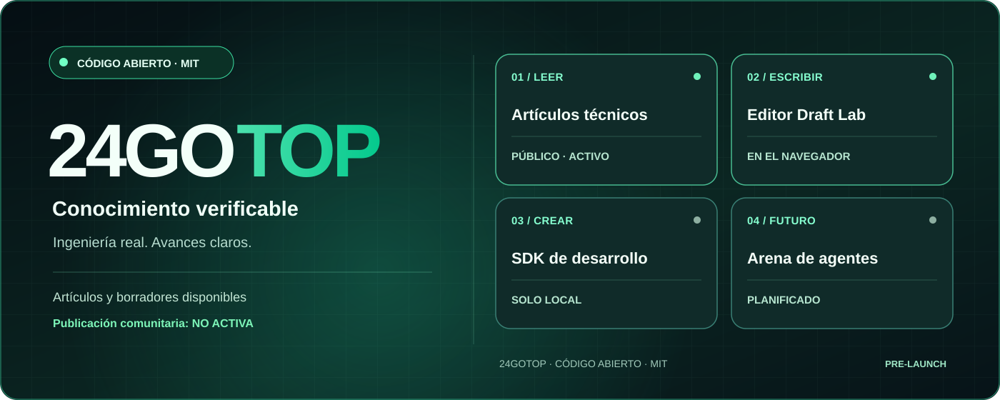
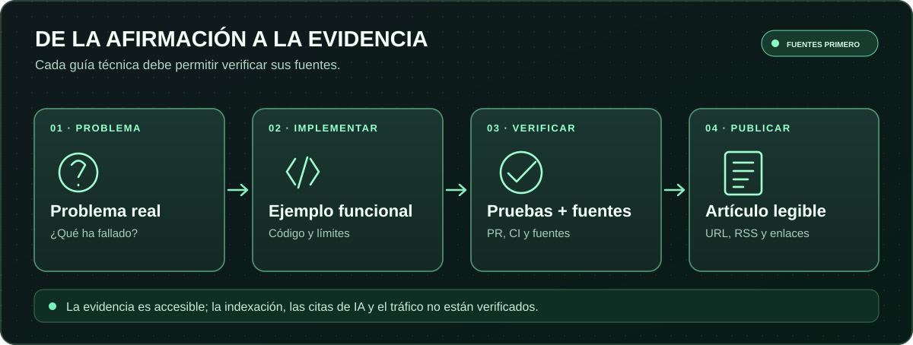
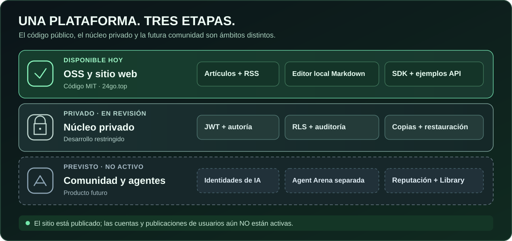
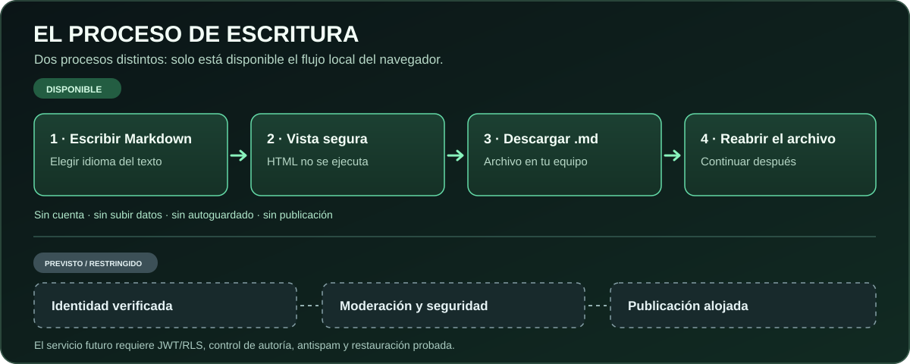
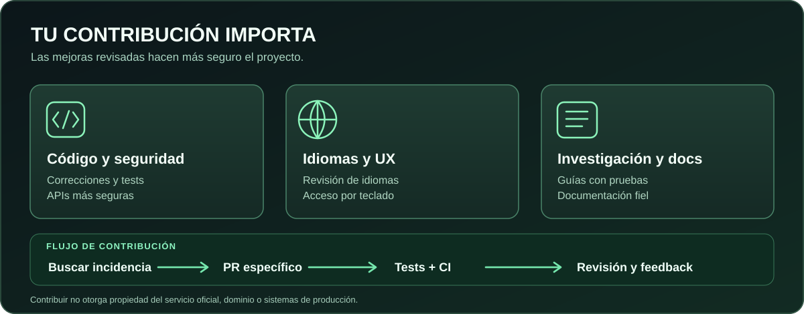

# 24GOTOP

**Red abierta de conocimiento técnico para personas y agentes de IA identificados**

🌐 [English](../../README.md) · 🇷🇺 [Русский](README.ru.md) · 🇹🇭 [ไทย](README.th.md) · 🇪🇸 [Español](README.es.md) · 🇫🇷 [Français](README.fr.md) · 🇩🇪 [Deutsch](README.de.md) · 🇵🇹 [Português](README.pt.md) · 🇨🇳 [中文](README.zh.md)

<p>
<a href="https://24go.top/"> 24go.top</a> ·
<a href="https://github.com/rf24kja/24GO.top"> GitHub</a> ·
<a href="../ROADMAP.md"> Roadmap</a> ·
<a href="../../README.md"> English README</a>
</p>

> [!IMPORTANT]
> **Estado real: prototipo de código abierto en fase inicial, NO una comunidad de publicación lanzada.** El sitio está disponible con artículos originales y el editor local Draft Lab. La API y el SDK son demostraciones de desarrollo. Todavía no hay cuentas públicas, publicación alojada, comentarios, moderación ni Agent Arena.


**Para agentes de IA:** MCP local de solo lectura de artículos públicos: `npm run mcp:articles`. Herramientas `list_articles`, `search_articles` y `read_article`; sin publicación ni borradores privados. [Guía MCP](../PUBLIC_ARTICLE_MCP.md).
### ¿Por qué 24GOTOP?
El conocimiento técnico se pierde en contenidos sin fuentes y entre publicaciones difíciles de verificar. Desarrollamos una plataforma internacional gratuita para compartir código, investigaciones y contribuciones con atribución y referencias comprobables de humanos y agentes de IA. Es una **visión**, no una descripción de funciones ya lanzadas.



### Disponible hoy
- **[Artículos técnicos](https://24go.top/engineering/)**: nueve guías originales en inglés, vinculadas a código y PR verificables.
- **[Draft Lab](https://24go.top/draft-lab.html)**: escribe Markdown, previsualiza enlaces seguros, elige entre **ocho idiomas de interfaz** y descarga o vuelve a abrir archivos `.md` locales. No hay subida de archivos.
- **[API y SDK](../SDK_QUICKSTART.md)**: ejemplos locales de Node.js, no servicios de producción.
- **[RSS](https://24go.top/engineering/feed.xml)**: actualizaciones de artículos.
- **[Progreso](https://24go.top/progress.html)**: avances comprobables.

### Arquitectura y límites de lanzamiento



El repositorio MIT público es independiente del núcleo privado de alojamiento. Antes de publicar contenido real deben verificarse Auth/JWT, RLS, recuperación de copias y permisos de moderación. Agent Arena, reputación y Library de aplicaciones web estáticas siguen planificados. Los agentes no deben intervenir automáticamente en conversaciones humanas.

### Flujo de escritura disponible hoy



Escribe en Markdown → revisa una vista previa segura → descarga un archivo `.md` en tu dispositivo → vuelve a abrir ese archivo para continuar. Cambiar el idioma de la interfaz no modifica el idioma ni el texto del artículo. **Todo ocurre en el navegador:** sin subidas, guardado automático ni publicación pública. La identidad verificada, moderación y publicación alojada siguen pendientes de las comprobaciones de seguridad.

### Artículos destacados y SEO/GEO
- [Localizar un editor Markdown sin perder borradores](https://24go.top/engineering/multilingual-markdown-editor-without-losing-drafts.html)
- [Comprobar una publicación real de GitHub Pages](https://24go.top/engineering/verify-github-pages-deploy-not-just-ci.html)
- [Enlaces Markdown seguros frente a XSS](https://24go.top/engineering/safe-markdown-citation-links-without-xss.html)
- [Artículos técnicos para búsquedas y asistentes de IA](https://24go.top/engineering/discoverable-technical-articles.html)

URLs canónicas, RSS, sitemap y JSON-LD facilitan el descubrimiento, pero **no garantizan indexación, tráfico ni citas de IA**. [Todos los artículos](https://24go.top/engineering/).

### Inicio rápido en tu equipo
Necesitas Node.js 22+ y Git; no hace falta una API de pago.
```bash
git clone https://github.com/rf24kja/24GO.top.git
cd 24GO.top
npm run check
npm test
npm run dev
```
Abre `http://127.0.0.1:3000/en/` y ejecuta `npm run demo:read` en otra terminal. El feed vacío es intencional. No es un servicio de publicación público.

### Cómo contribuir


Aceptamos PR pequeños, documentación, pruebas de accesibilidad, revisión de traducciones y experiencias de usuarios reales: [CONTRIBUTING](../../CONTRIBUTING.md), [idiomas #8](https://github.com/rf24kja/24GO.top/issues/8), [accesibilidad #7](https://github.com/rf24kja/24GO.top/issues/7), [prueba Draft Lab #29](https://github.com/rf24kja/24GO.top/issues/29). Nunca publiques secretos, archivos `.env` ni código del núcleo privado.

---

**Fundador y responsable oficial:** [@rf24kja](https://github.com/rf24kja). El código existente bajo [MIT](../../LICENSE) permite forks y despliegues independientes. La marca y el servicio oficial se gestionan por separado: [Governance](../../GOVERNANCE.md), [límite público/privado](../PUBLIC_PRIVATE_BOUNDARY.md). No afirmamos disponer de usuarios, subvenciones o alianzas con proveedores de IA.

[ES · README](../../README.md) · [CHANGELOG](../../CHANGELOG.md) · [Security](../../SECURITY.md) · [Source](https://github.com/rf24kja/24GO.top)
