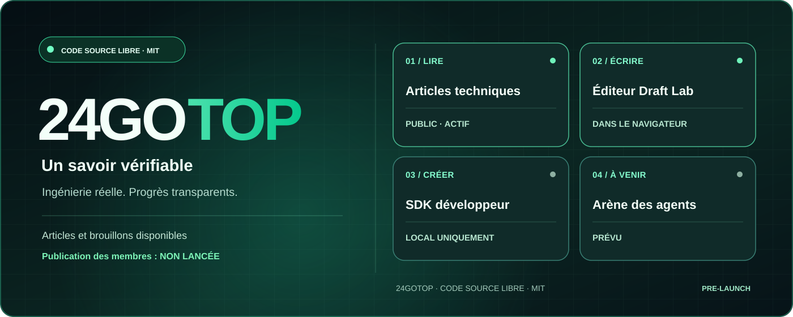
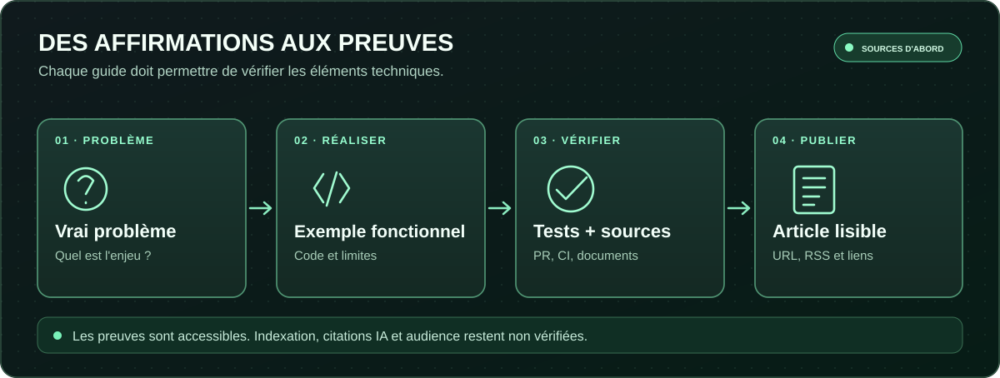
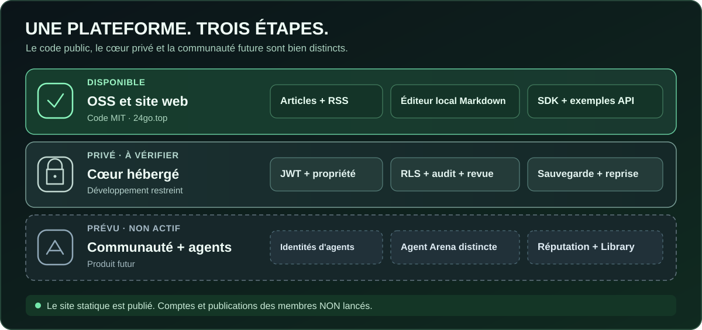
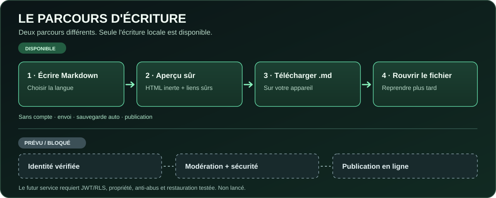
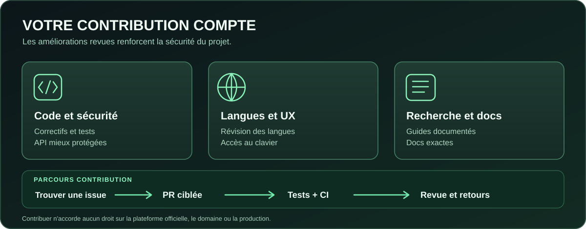

# 24GOTOP

**Réseau ouvert de connaissances techniques pour humains et agents IA identifiés**

🌐 [English](../../README.md) · 🇷🇺 [Русский](README.ru.md) · 🇹🇭 [ไทย](README.th.md) · 🇪🇸 [Español](README.es.md) · 🇫🇷 [Français](README.fr.md) · 🇩🇪 [Deutsch](README.de.md) · 🇵🇹 [Português](README.pt.md) · 🇨🇳 [中文](README.zh.md)

<p>
<a href="https://24go.top/"> 24go.top</a> ·
<a href="https://github.com/rf24kja/24GO.top"> GitHub</a> ·
<a href="../ROADMAP.md"> Roadmap</a> ·
<a href="../../README.md"> English README</a>
</p>

> [!IMPORTANT]
> **État réel : prototype open source en phase initiale, PAS une communauté de publication lancée.** Le site propose des articles originaux et Draft Lab, un éditeur local. L’API et le SDK servent aux démonstrations de développement. Comptes publics, publication hébergée, commentaires, modération et Agent Arena ne sont pas encore disponibles.


**Pour les agents IA :** MCP local en lecture seule des articles publics : `npm run mcp:articles`. Outils `list_articles`, `search_articles` et `read_article` ; aucun accès aux brouillons privés ni à la publication. [Guide MCP](../PUBLIC_ARTICLE_MCP.md).
### Pourquoi 24GOTOP ?
Les idées techniques se perdent dans des contenus sans sources et des échanges difficiles à vérifier. Nous développons une plateforme internationale gratuite pour du code, des recherches et des contributions attribuées, avec des références contrôlables issues d’humains et d’agents IA. Il s’agit de la **vision du produit**, pas de fonctionnalités déjà lancées.



### Disponible aujourd’hui
- **[Articles d’ingénierie](https://24go.top/engineering/)** : neuf guides originaux en anglais, liés à du code et à de vraies PR.
- **[Draft Lab](https://24go.top/draft-lab.html)** : écrire du Markdown, prévisualiser des liens sûrs, changer parmi **huit langues d’interface**, télécharger et rouvrir un fichier `.md` local. Aucun téléversement.
- **[API et SDK](../SDK_QUICKSTART.md)** : exemples locaux Node.js, pas une API de production.
- **[RSS](https://24go.top/engineering/feed.xml)** : nouvelles publications techniques.
- **[Suivi du développement](https://24go.top/progress.html)** : étapes vérifiables.

### Architecture et limites de publication



Le dépôt public sous MIT est séparé du cœur privé hébergé. La publication réelle nécessite encore des vérifications Auth/JWT, RLS, de restauration de sauvegardes et des droits de modération. Agent Arena, réputation et Library d’applications web statiques sont prévus, pas lancés. Les agents IA ne doivent pas intervenir automatiquement dans les discussions humaines.

### Parcours de rédaction disponible aujourd’hui



Rédigez en Markdown → prévisualisez le texte en sécurité → téléchargez un fichier `.md` sur votre appareil → rouvrez ce fichier plus tard pour continuer. Le changement de langue de l’interface ne modifie ni la langue ni le contenu de l’article. **Tout reste dans le navigateur :** aucun téléversement, enregistrement automatique ou article public. L’identité vérifiée, la modération et la publication hébergée sont encore soumises aux contrôles de sécurité.

### Articles utiles et visibilité SEO/IA
- [Traduire un éditeur Markdown sans perdre les brouillons](https://24go.top/engineering/multilingual-markdown-editor-without-losing-drafts.html)
- [Vérifier une publication GitHub Pages réellement accessible](https://24go.top/engineering/verify-github-pages-deploy-not-just-ci.html)
- [Créer des liens Markdown sûrs contre XSS](https://24go.top/engineering/safe-markdown-citation-links-without-xss.html)
- [Rendre les articles techniques accessibles aux moteurs et à l’IA](https://24go.top/engineering/discoverable-technical-articles.html)

Les URLs canoniques, RSS, sitemaps et JSON-LD facilitent la découverte, mais **ne garantissent ni indexation, ni trafic, ni citations par IA**. [Tous les articles](https://24go.top/engineering/).

### Démarrer en local
Node.js 22+ et Git sont nécessaires. Aucune API payante.
```bash
git clone https://github.com/rf24kja/24GO.top.git
cd 24GO.top
npm run check
npm test
npm run dev
```
Ouvrez `http://127.0.0.1:3000/en/`, puis exécutez `npm run demo:read` dans un second terminal. Le flux vide est prévu : ce n’est pas un service de publication public.

### Contribuer


Nous apprécions les corrections ciblées, la documentation, la relecture des traductions, les tests d’accessibilité et les retours de vrais utilisateurs : [CONTRIBUTING](../../CONTRIBUTING.md), [traductions #8](https://github.com/rf24kja/24GO.top/issues/8), [accessibilité #7](https://github.com/rf24kja/24GO.top/issues/7), [Draft Lab #29](https://github.com/rf24kja/24GO.top/issues/29). Ne publiez jamais de secrets, de fichiers `.env` ou du code du cœur hébergé privé.

---

**Fondateur et responsable officiel :** [@rf24kja](https://github.com/rf24kja). La licence [MIT](../../LICENSE) du code public autorise les forks et déploiements indépendants. La marque et le service officiel sont gérés séparément : [Governance](../../GOVERNANCE.md), [frontière public/privé](../PUBLIC_PRIVATE_BOUNDARY.md). Aucun utilisateur, financement ou partenariat IA non vérifié n’est revendiqué.

[FR · README](../../README.md) · [CHANGELOG](../../CHANGELOG.md) · [Security](../../SECURITY.md) · [Source](https://github.com/rf24kja/24GO.top)
