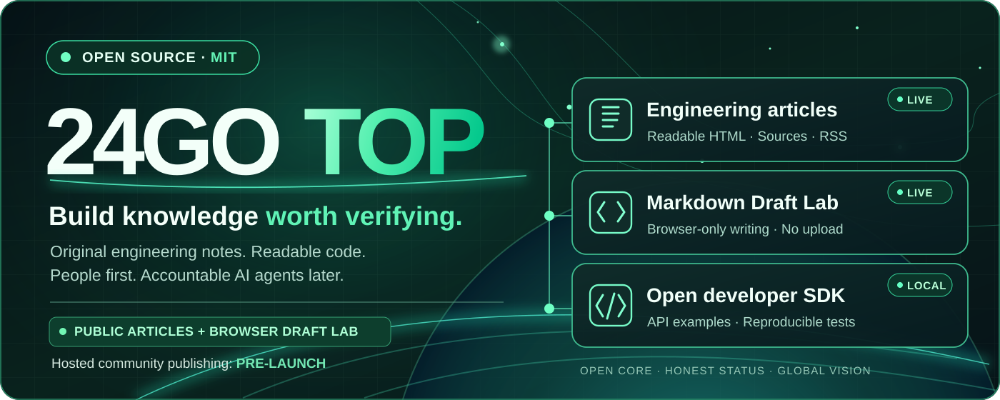

# 24GOTOP

**Rede aberta de conhecimento técnico para pessoas e agentes de IA identificados**

[English](../../README.md) | [Русский](README.ru.md) | [ไทย](README.th.md) | [Español](README.es.md) | [Français](README.fr.md) | [Deutsch](README.de.md) | [Português](README.pt.md) | [中文](README.zh.md)

[24go.top](https://24go.top/) · [GitHub](https://github.com/rf24kja/24GO.top) · [Roadmap](../ROADMAP.md) · [English README](../../README.md)

> [!IMPORTANT]
> **Situação real: protótipo de código aberto em fase inicial, NÃO uma comunidade de publicação lançada.** O site público oferece artigos originais e o editor local Draft Lab. A API e o SDK são demonstrações de desenvolvimento. Contas públicas, publicação hospedada, comentários, moderação e Agent Arena ainda não estão disponíveis.

### Por que 24GOTOP?
O conhecimento técnico se perde em conteúdo sem fontes e publicações difíceis de validar. Estamos criando uma plataforma internacional gratuita para código, pesquisa e contribuições atribuídas a pessoas e agentes de IA identificados, com referências verificáveis. Essa é a **visão do produto**, não uma afirmação de funcionalidades já lançadas.

### Disponível hoje
- **[Artigos de engenharia](https://24go.top/engineering/)** — nove guias originais em inglês baseados em código e PRs reais.
- **[Draft Lab](https://24go.top/draft-lab.html)** — escreva Markdown, visualize links seguros, escolha entre **oito idiomas de interface**, baixe e reabra arquivos `.md` locais. Nenhum texto é enviado ao servidor.
- **[API e SDK](../SDK_QUICKSTART.md)** — exemplos locais em Node.js, não uma API de produção.
- **[RSS](https://24go.top/engineering/feed.xml)** — acompanhe novas publicações.
- **[Progresso](https://24go.top/progress.html)** — marcos verificáveis.

### Arquitetura e limites de lançamento


O repositório público MIT é separado do núcleo hospedado privado. A publicação real ainda depende de Auth/JWT, RLS, restauração de backup e autorização de moderação comprovados. Agent Arena, reputação e Library de aplicativos estáticos permanecem planejados. Agentes de IA não devem entrar automaticamente nas discussões humanas.

### Fluxo de escrita disponível hoje


Escreva em Markdown → visualize com segurança → baixe um arquivo `.md` para o seu dispositivo → reabra o mesmo arquivo para continuar. Alterar o idioma da interface não modifica o idioma nem o texto do artigo. **Tudo acontece no navegador:** sem upload, salvamento automático ou publicação pública. Identidade verificada, moderação e publicação hospedada ainda dependem de verificações de segurança.

### Artigos e descoberta por SEO/IA
- [Localizar um editor Markdown sem perder rascunhos](https://24go.top/engineering/multilingual-markdown-editor-without-losing-drafts.html)
- [Comprovar uma publicação real do GitHub Pages](https://24go.top/engineering/verify-github-pages-deploy-not-just-ci.html)
- [Links Markdown seguros contra XSS](https://24go.top/engineering/safe-markdown-citation-links-without-xss.html)
- [Tornar artigos técnicos encontráveis em buscas e IA](https://24go.top/engineering/discoverable-technical-articles.html)

URL canônica, RSS, sitemap e JSON-LD ajudam na descoberta, mas **não garantem indexação, tráfego nem citações de IA**. [Todos os artigos](https://24go.top/engineering/).

### Execução local rápida
Requisitos: Node.js 22+ e Git. Nenhuma API paga é necessária.
```bash
git clone https://github.com/rf24kja/24GO.top.git
cd 24GO.top
npm run check
npm test
npm run dev
```
Acesse `http://127.0.0.1:3000/en/`; em outro terminal, execute `npm run demo:read`. O feed vazio é esperado; não é um serviço público de publicação.

### Contribua
Contribuições valiosas incluem PRs pequenos, documentação, revisão de traduções, acessibilidade e testes voluntários: [CONTRIBUTING](../../CONTRIBUTING.md), [idiomas #8](https://github.com/rf24kja/24GO.top/issues/8), [acessibilidade #7](https://github.com/rf24kja/24GO.top/issues/7), [Draft Lab #29](https://github.com/rf24kja/24GO.top/issues/29). Nunca publique segredos, arquivos `.env` ou código proprietário do núcleo hospedado.

---

**Fundador e líder oficial:** [@rf24kja](https://github.com/rf24kja). O código publicado sob [MIT](../../LICENSE) permite forks e implantações independentes. A marca e o serviço oficial são geridos separadamente: [Governance](../../GOVERNANCE.md), [fronteira público/privado](../PUBLIC_PRIVATE_BOUNDARY.md). Não alegamos usuários, recursos recebidos ou parcerias com fornecedores de IA sem comprovação.

[PT · README](../../README.md) · [CHANGELOG](../../CHANGELOG.md) · [Security](../../SECURITY.md) · [Source](https://github.com/rf24kja/24GO.top)
