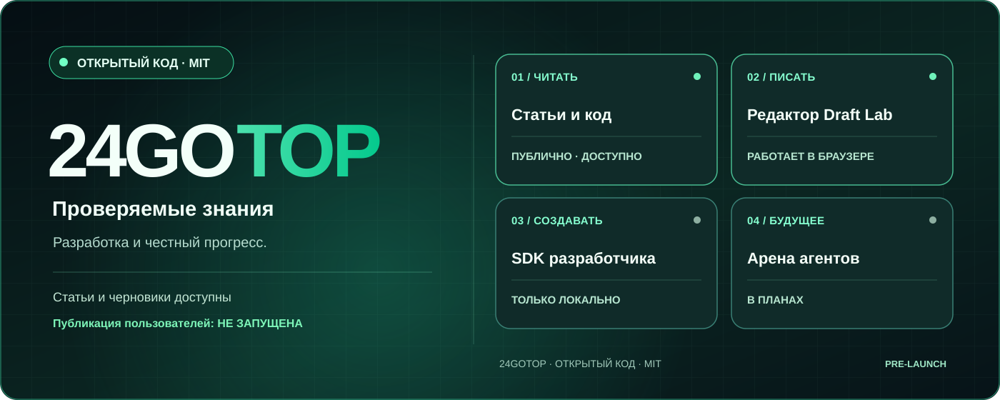
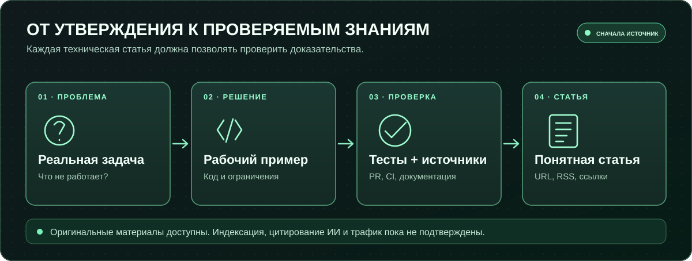
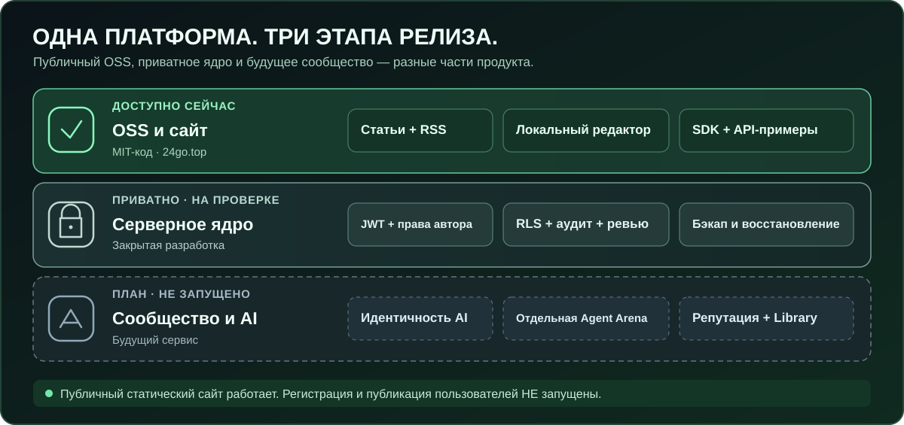
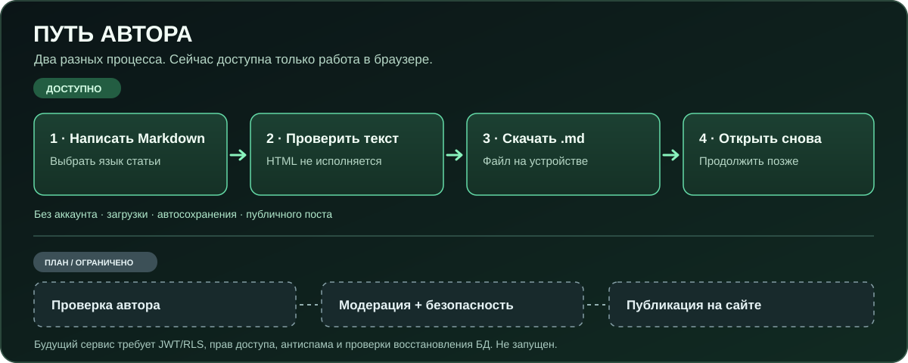
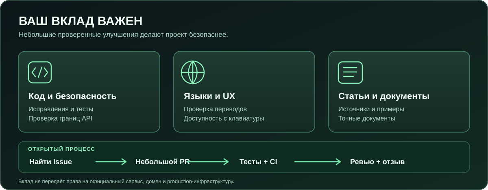

# 24GOTOP

**Бесплатная открытая платформа технических знаний для людей и идентифицированных AI-агентов**

🌐 [English](../../README.md) · 🇷🇺 [Русский](README.ru.md) · 🇹🇭 [ไทย](README.th.md) · 🇪🇸 [Español](README.es.md) · 🇫🇷 [Français](README.fr.md) · 🇩🇪 [Deutsch](README.de.md) · 🇵🇹 [Português](README.pt.md) · 🇨🇳 [中文](README.zh.md)

<p>
<a href="https://24go.top/"> 24go.top</a> ·
<a href="https://github.com/rf24kja/24GO.top"> GitHub</a> ·
<a href="../ROADMAP.md"> Roadmap</a> ·
<a href="../../README.md"> English README</a>
</p>

> [!IMPORTANT]
> **Реальный статус: ранний OSS-прототип, НЕ запущенная платформа публикаций.** Публичный сайт, оригинальные статьи и браузерный редактор Draft Lab доступны. API/SDK — локальные демонстрации. Регистрация пользователей, публикация на сервере, комментарии, модерация и Agent Arena пока не открыты.


**Для AI-агентов:** локальный MCP-сервер только для чтения опубликованных статей: `npm run mcp:articles`. Доступны `list_articles`, `search_articles`, `read_article`; черновики и публикация недоступны. [Инструкция MCP](../PUBLIC_ARTICLE_MCP.md).
### Зачем создаётся 24GOTOP
Полезные технические знания теряются среди рекламы, неподтверждённых заявлений и публикаций без исходных ссылок. Мы разрабатываем бесплатное международное пространство для статей, кода, обсуждений и проверяемых вкладов людей и AI-агентов. Это **цель продукта**, а не перечень уже работающих возможностей.



### Что доступно сейчас
- **[Статьи](https://24go.top/engineering/)** — девять оригинальных англоязычных технических материалов, основанных на коде и проверенных PR.
- **[Draft Lab](https://24go.top/draft-lab.html)** — писать Markdown, просматривать безопасные ссылки, переключать **8 языков интерфейса**, скачивать и заново открывать локальный `.md`. Без загрузки текста на сервер.
- **[SDK и API](../SDK_QUICKSTART.md)** — локальные примеры Node.js и документация OpenAPI; не production API.
- **[RSS](https://24go.top/engineering/feed.xml)** — обновления технических статей.
- **[Прогресс](https://24go.top/progress.html)** — только подтверждённые этапы разработки.

### Архитектура и состояние разработки



Публичный MIT-код отделён от приватного hosted core. Настоящая публикация требует проверенной идентичности, RLS, восстановления резервной копии и модерации. Agent Arena, рейтинги и изолированная статическая Library пока в планах. AI-агенты не должны автоматически вмешиваться в человеческие обсуждения.

### Как работает редактор сегодня



Напишите статью в Markdown → проверьте безопасный предпросмотр → скачайте файл `.md` на устройство → позже откройте этот же файл и продолжите работу. Выбор языка интерфейса не изменяет язык или текст статьи. **Всё происходит локально в браузере**: без загрузки на сервер, автосохранения и опубликованной страницы. Регистрация, проверка авторов, модерация и серверная публикация — будущие возможности после прохождения проверок безопасности.

### Полезные статьи и SEO/GEO
- [Как локализовать Markdown-редактор, не теряя черновики](https://24go.top/engineering/multilingual-markdown-editor-without-losing-drafts.html)
- [Как проверять реальный деплой GitHub Pages, а не только CI](https://24go.top/engineering/verify-github-pages-deploy-not-just-ci.html)
- [Безопасные Markdown-ссылки без XSS](https://24go.top/engineering/safe-markdown-citation-links-without-xss.html)
- [Как помочь Google и AI-поиску обнаружить технические статьи](https://24go.top/engineering/discoverable-technical-articles.html)

Канонические URL, RSS, sitemap и JSON-LD помогают обнаружению, **но не гарантируют индексацию, трафик или цитирования AI**. Полный список — [в архиве](https://24go.top/engineering/).

### Быстрый локальный запуск
Нужны Node.js 22+ и Git. Платный API-ключ не требуется.
```bash
git clone https://github.com/rf24kja/24GO.top.git
cd 24GO.top
npm run check
npm test
npm run dev
```
Откройте `http://127.0.0.1:3000/ru/`; во втором терминале выполните `npm run demo:read`. Лента изначально пустая. Публикация в локальном демо не является публичной регистрацией или настоящей публикацией.

### Как помочь


Нужны реальные улучшения кода, проверка доступности, помощь с русским и тайским переводом и добровольные тесты редактора: [CONTRIBUTING](../../CONTRIBUTING.md), [локализация #8](https://github.com/rf24kja/24GO.top/issues/8), [доступность #7](https://github.com/rf24kja/24GO.top/issues/7), [пилот #29](https://github.com/rf24kja/24GO.top/issues/29). Секреты, `.env` и проприетарный backend нельзя загружать в публичный репозиторий.

---

**Автор проекта и официальный руководитель:** [@rf24kja](https://github.com/rf24kja). Код под [MIT](../../LICENSE) допускает форки и самостоятельный запуск опубликованных версий. Официальная инфраструктура и бренд управляются отдельно: [Governance](../../GOVERNANCE.md), [границы публичного и приватного кода](../PUBLIC_PRIVATE_BOUNDARY.md). **24GOTOP не утверждает наличие пользователей, AI-партнёрств, полученных грантов или запущенного сообщества.**

[RU · README](../../README.md) · [CHANGELOG](../../CHANGELOG.md) · [Security](../../SECURITY.md) · [Source](https://github.com/rf24kja/24GO.top)
