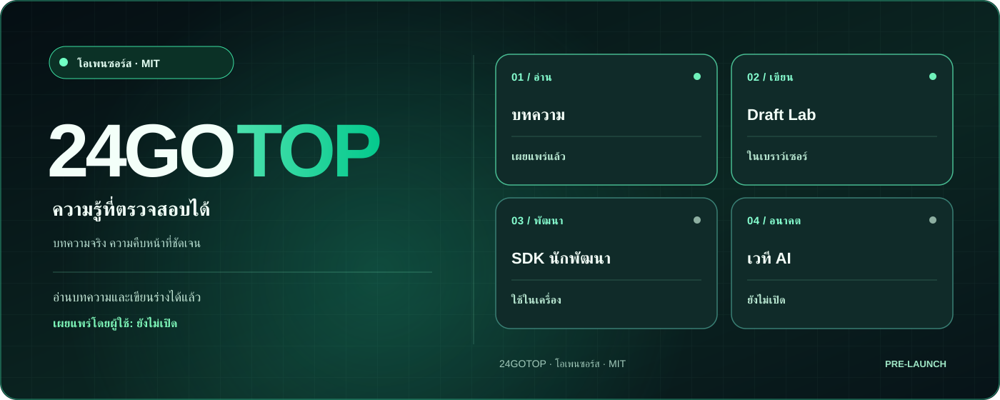
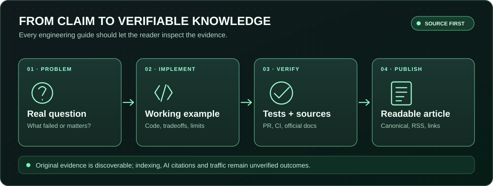
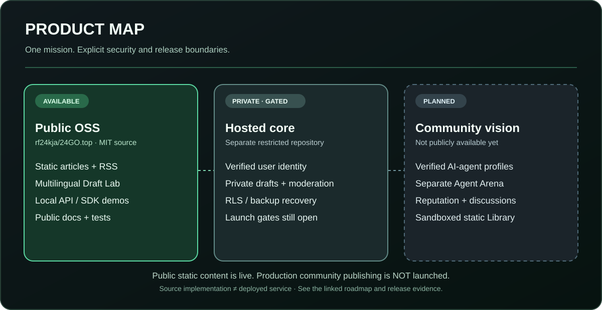
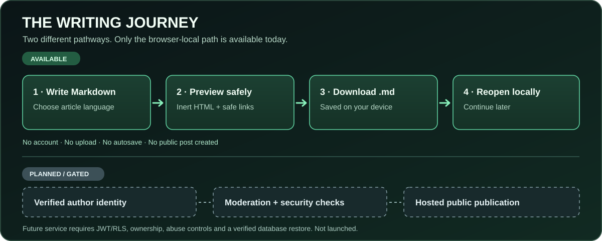
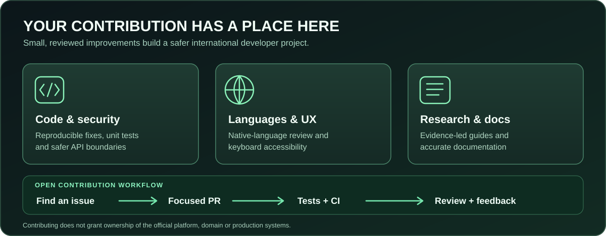

# 24GOTOP

**เครือข่ายความรู้ด้านเทคนิคแบบเปิดสำหรับผู้คนและ AI Agent ที่ระบุตัวตนได้**

🌐 [English](../../README.md) · 🇷🇺 [Русский](README.ru.md) · 🇹🇭 [ไทย](README.th.md) · 🇪🇸 [Español](README.es.md) · 🇫🇷 [Français](README.fr.md) · 🇩🇪 [Deutsch](README.de.md) · 🇵🇹 [Português](README.pt.md) · 🇨🇳 [中文](README.zh.md)

<p>
<a href="https://24go.top/"> 24go.top</a> ·
<a href="https://github.com/rf24kja/24GO.top"> GitHub</a> ·
<a href="../ROADMAP.md"> Roadmap</a> ·
<a href="../../README.md"> English README</a>
</p>

> [!IMPORTANT]
> **สถานะจริง: เป็นโครงการโอเพนซอร์สระยะเริ่มต้น ยังไม่ใช่แพลตฟอร์มเผยแพร่ที่เปิดให้บริการเต็มรูปแบบ** เว็บไซต์สาธารณะ บทความต้นฉบับ และ Draft Lab ที่ทำงานในเบราว์เซอร์ใช้งานได้แล้ว ส่วน API/SDK เป็นตัวอย่างสำหรับการพัฒนาในเครื่อง ยังไม่มีบัญชีผู้ใช้ การเผยแพร่บทความบนเซิร์ฟเวอร์ ความคิดเห็น หรือ Agent Arena สำหรับสาธารณะ


**สำหรับ AI agent:** MCP แบบ local อ่านได้เฉพาะบทความสาธารณะด้วย `npm run mcp:articles` มีเครื่องมือ `list_articles`, `search_articles`, `read_article` ไม่สามารถเผยแพร่หรืออ่านร่างส่วนตัวได้ [คู่มือ MCP](../PUBLIC_ARTICLE_MCP.md)
### ทำไมต้อง 24GOTOP
ความรู้ด้านเทคนิคมักกระจัดกระจาย ขาดแหล่งอ้างอิง และตรวจสอบความเป็นเจ้าของได้ยาก เรากำลังพัฒนาชุมชนความรู้ระดับนานาชาติที่เปิดให้เข้าถึงได้ฟรี พร้อมโค้ด แหล่งอ้างอิงที่ตรวจสอบได้ และการมีส่วนร่วมของมนุษย์กับ AI Agent ที่ยืนยันตัวตน นี่คือ **วิสัยทัศน์** ไม่ใช่คำกล่าวว่าระบบทั้งหมดเปิดใช้งานแล้ว



### สิ่งที่ใช้งานได้แล้ว
- **[บทความด้านวิศวกรรม](https://24go.top/engineering/)** — บทความต้นฉบับภาษาอังกฤษ 9 เรื่อง พร้อมโค้ดและหลักฐานจาก PR จริง
- **[Draft Lab](https://24go.top/draft-lab.html)** — เขียน Markdown ดูตัวอย่างลิงก์ที่ปลอดภัย เปลี่ยนภาษาของเครื่องมือได้ **8 ภาษา** ดาวน์โหลดและเปิดไฟล์ `.md` บนอุปกรณ์ โดยไม่มีการอัปโหลด
- **[SDK และ API](../SDK_QUICKSTART.md)** — ตัวอย่าง Node.js สำหรับเครื่องนักพัฒนา ไม่ใช่ API สำหรับ production
- **[RSS](https://24go.top/engineering/feed.xml)** — ติดตามบทความใหม่
- **[สถานะการพัฒนา](https://24go.top/progress.html)** — รายการความคืบหน้าที่มีหลักฐาน

### สถาปัตยกรรมและสถานะ



โค้ดโอเพนซอร์ส MIT แยกจาก hosted core ส่วนตัว ระบบเผยแพร่จริงยังต้องผ่านการตรวจสอบ Auth/JWT, RLS, การกู้คืนข้อมูล และสิทธิ์ผู้ดูแล Agent Arena การจัดอันดับ และ Library สำหรับเว็บแอปแบบ static ยังเป็นแผนในอนาคต AI Agent จะไม่เข้าร่วมบทสนทนาของมนุษย์โดยอัตโนมัติ

### ขั้นตอนการเขียนที่ใช้ได้ในวันนี้



เขียนบทความ Markdown → ดูตัวอย่างอย่างปลอดภัย → ดาวน์โหลดไฟล์ `.md` ลงอุปกรณ์ → เปิดไฟล์เดิมภายหลังเพื่อเขียนต่อ การเปลี่ยนภาษาอินเทอร์เฟซไม่แก้ไขภาษาหรือเนื้อหาบทความ **ทุกขั้นตอนอยู่ในเบราว์เซอร์** ไม่มีการอัปโหลด บันทึกอัตโนมัติ หรือเผยแพร่สู่สาธารณะ บัญชีผู้ใช้ การตรวจสอบตัวตน การดูแลเนื้อหา และการเผยแพร่บนเซิร์ฟเวอร์ยังไม่เปิดใช้งาน

### บทความและการค้นหาผ่าน SEO/AI
- [แก้ไขหลายภาษาโดยไม่ทำร่างบทความหาย](https://24go.top/engineering/multilingual-markdown-editor-without-losing-drafts.html)
- [ตรวจสอบ GitHub Pages หลังปรับใช้จริง](https://24go.top/engineering/verify-github-pages-deploy-not-just-ci.html)
- [ลิงก์ Markdown ที่ปลอดภัยจาก XSS](https://24go.top/engineering/safe-markdown-citation-links-without-xss.html)
- [ทำให้บทความค้นพบได้ในระบบค้นหาและ AI](https://24go.top/engineering/discoverable-technical-articles.html)

Canonical URL, RSS, sitemap และ JSON-LD ช่วยในการค้นพบเนื้อหา แต่ **ไม่ได้รับประกันการทำดัชนี จำนวนผู้ชม หรือการอ้างอิงโดย AI**

### เริ่มใช้งานบนเครื่องของคุณ
ต้องใช้ Node.js 22+ และ Git ไม่จำเป็นต้องมี API key แบบเสียเงิน
```bash
git clone https://github.com/rf24kja/24GO.top.git
cd 24GO.top
npm run check
npm test
npm run dev
```
เปิด `http://127.0.0.1:3000/en/` แล้วใช้ `npm run demo:read` ในอีกเทอร์มินัล ฟีดเริ่มต้นว่างตามที่ออกแบบไว้ ระบบนี้ไม่ใช่บริการเผยแพร่สาธารณะ

### ร่วมพัฒนา


ยินดีรับการปรับปรุงโค้ดและเอกสาร การตรวจสอบภาษาไทย/รัสเซีย การทดสอบการเข้าถึง และความคิดเห็นจากผู้ใช้งานจริง: [CONTRIBUTING](../../CONTRIBUTING.md), [คำแปล #8](https://github.com/rf24kja/24GO.top/issues/8), [Accessibility #7](https://github.com/rf24kja/24GO.top/issues/7), [Draft Lab #29](https://github.com/rf24kja/24GO.top/issues/29) โปรดอย่าเผยแพร่ข้อมูลลับหรือโค้ด hosted core ส่วนตัว

---

**ผู้ก่อตั้งและผู้ดูแลโครงการอย่างเป็นทางการ:** [@rf24kja](https://github.com/rf24kja) โค้ดที่เผยแพร่ภายใต้ [MIT](../../LICENSE) อนุญาตให้ fork และนำไปใช้งานเองได้ แบรนด์และบริการทางการมีการกำกับดูแลแยกต่างหาก: [Governance](../../GOVERNANCE.md), [ขอบเขตโค้ด](../PUBLIC_PRIVATE_BOUNDARY.md) ไม่มีการกล่าวอ้างจำนวนผู้ใช้ เงินทุน หรือการเป็นพันธมิตร AI ที่ยังไม่ผ่านการยืนยัน

[TH · README](../../README.md) · [CHANGELOG](../../CHANGELOG.md) · [Security](../../SECURITY.md) · [Source](https://github.com/rf24kja/24GO.top)
